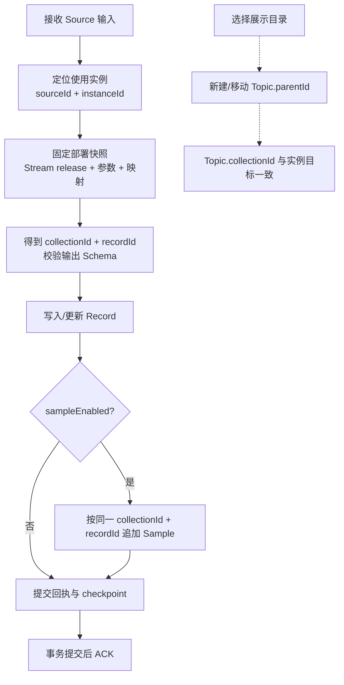

# UNS 数据模型与关系

目标设计；工程实施资料见仓库内 `doc/uns-v2/README.md`，当前接口以 [OpenAPI v2 总册](../openapi-v2.md) 为准。SQL 字段用下划线，JSON 与 API 字段用小驼峰。API 中所有 ID 都是字符串，时间统一 Unix 毫秒。

## 1. kind 枚举

`uns_meta` 主键为 `(kind,id)`；同一个 id 可以用于不同 kind，查询、更新与缓存键需要固定类型。Namespace 的 directory/topic 在服务中共用 ID 命名空间，避免 parentId、树节点和入口路由产生歧义。

| kind | 一行代表什么 | data 核心内容 | 进入 UNS 树 | 写入主体 |
| --- | --- | --- | --- | --- |
| directory | 目录 | schemaVersion、name、description、parentId | 是，非叶子类型，可暂时为空 | 元数据管理 |
| topic | 展示叶子 | schemaVersion、name、parentId、viewMode、collectionId 或 fields | 是，不允许子节点 | 元数据管理 |
| collection | 数据集合定义 | schemaVersion、name、recordSchema、sampleSchema | 否，由 Topic 展示 | 集合管理 |
| source | 连接与 Stream 使用实例 | name、adapter、config.connection、config.streams | 否 | 来源管理 |
| stream | 独立、可发布的处理配置 | name、executionMode、draft、releases | 否 | Stream 管理/发布命令 |
| source_state | 同 ID Source 的运行状态 | health、checkedAt、streams[instanceId] | 否 | 运行器，只读查询 |
| app | App 访问配置 | name、roles、members、collections、navigation、credentialRef | 否 | App 授权管理 |
| source_plan | 自动接入建议 | status、proposal、result、ownerAppId | 否 | 生成/应用方案命令 |
| source_version | 外部记录版本与删除标记 | sourceId、instanceId、externalId、version、deleted | 否 | 接入服务 |
| subscription | 订阅配置 | 订阅范围、目的地、凭据引用、启用状态 | 否 | 订阅领域命令 |
| task | 持久化任务、回执或幂等凭据 | type、status、租约、重试、结果、幂等身份 | 否 | 对应运行服务 |

业务配置 data 均增加 `schemaVersion: 1`。系统 kind 的内部 payload 仍由所属领域维护版本，通用元数据 API 不能任意改写。枚举完整不等于所有 kind 都开放通用 CRUD。

### Collection 是什么

Collection 是“一组遵守同一结构的数据”的定义与归属边界，不是一张新的物理业务表，也不是一个树目录。

| 以前熟悉的概念 | 本模型中的表达 | 注意 |
| --- | --- | --- |
| State，例如工位资料/当前状态 | Collection.recordSchema + 多条 Record | 更新同一 Record；是否保留历史由业务决定 |
| Action，例如发货/操作记录 | 以事件标识创建独立 Record 的集合 | Action 的触发与执行另有业务语义，不能仅靠存一行替代 |
| Metric，例如温度测点 | recordSchema 定义测点，sampleSchema 定义每次采样 | Record 定义“测谁”，Sample 记录“何时、什么值” |

三者用于帮助理解，**不增加 state/action/metric 三种 meta.kind**。集合可同时有 Record 定义与 Sample 历史；不配置 sampleSchema 的集合仅保存 Record。

### 三张核心表

云端和企业版使用同一逻辑列集。Metadata 和 Record 的 created_at/updated_at 保留平台 Unix 毫秒 bigint，Sample 的 time/received_at 和 Record 的 source_time/deleted_at 使用 timestamptz；对外日期仍是小驼峰 Unix 毫秒。Record 的删除标记统一为 nullable deleted_at，已删除同步专用标记；默认查询与唯一键排除 tombstone。详细规则见 [统一契约](data-api.md)。

| 表 | 主键 | 核心字段与类型 | 职责 |
| --- | --- | --- | --- |
| uns_meta | kind + id | kind: varchar(32)；id: varchar(256)；data: jsonb；revision/created_at/updated_at/deleted_at: bigint | 定义、配置、运行状态；deleted_at=0 表示有效 |
| uns_record | collection_id + id | collection_id/id: varchar(128)；source_id: varchar(128), nullable；data: jsonb；revision/created_at/updated_at: bigint；source_time/deleted_at: timestamptz；租约字段 | 当前业务记录或测点定义；deleted_at IS NULL 为活动记录 |
| uns_sample | time + collection_id + record_id + id | 三个 ID: varchar(128)；time/received_at: timestamptz(3)；quality: varchar(64)；data: jsonb；source_id/stream_id/binding_id/producer_id/epoch/seq 等追踪字段 | 追加历史采样；业务时间与收到时间分开 |

保留已有列宽，公共 ID 校验取可引用列的共同约束：1～128 字符，符合现有 `ValidID`。Source/Stream 先继续由服务端生成十进制字符串 ID，内部适配现有 int64 运行接口，浏览器不得转 Number。其他对象可指定 ID 或由服务端生成。

三表均不再包含 `source_kind` / `collection_kind`。`uns_sample.(collection_id,record_id)` → `uns_record.(collection_id,id)` 保留数据库复合外键。指向 uns_meta 的引用由服务固定类型校验；数据表另有数据库触发器检查有效 Collection/Source，并与删除保护共用事务锁。删除辅助列后不再保留原复合外键。

| 关系 | 基数 | 保证方式 |
| --- | --- | --- |
| directory → 子 directory/topic | 1:N；子节点有 0/1 个父目录 | parentId 固定引用 directory；防环；根节点 parentId=null |
| records Topic → Collection | N:1 | collectionId 必填；一个 Collection 可被 0..N 个 Topic 展示 |
| Collection → Record | 1:N | Record.collectionId 固定引用 kind=collection |
| Record → Sample | 1:0..N | 两列复合外键；Sample 不可只按 recordId 跨集合查询 |
| Source → 运行状态 | 1:0..1 | kind=source_state 使用相同 id |
| Source → 使用实例 → Stream release | 1:N → N:1 | 使用实例位于 Source；引用已发布、不可变版本 |
| App → Collection | N:M | App.collections 显式授权；别名只在该 App 内有效 |

Sample 最新值按 `time DESC, id DESC` 定序；同毫秒使用 id 打破并列。迟到采样写历史，不覆盖更新的业务时间。API 返回 time 和 receivedAt，不将接收顺序冒充采样顺序。

## 2. 树节点与集合

目录示例：

```json
{
  "kind": "directory",
  "id": "d_workshop",
  "data": {"schemaVersion": 1, "name": "生产车间", "parentId": "d_factory"}
}
```

列表型 Topic：

```json
{
  "kind": "topic",
  "id": "t_signals",
  "data": {
    "schemaVersion": 1,
    "name": "温度测点",
    "parentId": "d_workshop",
    "viewMode": "records",
    "collectionId": "c_signal"
  }
}
```

`viewMode=records` 禁止 fields；`viewMode=fields` 使用 fields，禁止 collectionId。保留已有字段视图能力：一个字段明确选择 `kind=record/sample + collectionId + recordId + fieldPath`；后者取这个测点的最新采样。多个字段共同描述一个对象，各自有数据时间，不是跨集合多行 JOIN。

树只加载 directory/topic，使用 Namespace 中唯一的 id 定位；读取 Collection、Source 等其他对象必须固定 kind，避免跨类型误读。同一目录下 directory/topic 的名称共用唯一命名空间；拆 kind 时同步修改名称唯一索引，不能出现同名文件夹和 Topic 导致路径歧义。

```json
{
  "kind": "topic",
  "id": "t_turning",
  "data": {
    "schemaVersion": 1,
    "name": "车削工位",
    "parentId": "d_workshop",
    "viewMode": "fields",
    "fields": [
      {"name": "name", "displayName": "工位名称", "kind": "record", "collectionId": "c_station", "recordId": "turning", "fieldPath": "name"},
      {"name": "temperature", "displayName": "主轴温度", "kind": "sample", "collectionId": "c_signal", "recordId": "turning-temp", "fieldPath": "value"}
    ]
  }
}
```

移动 Topic 只改 parentId；删除 Topic 只移除展示入口。Collection 不跟着移动、删除；采集也不停止。被 Source 实例用作展示映射的 Topic 删除时，显式解除可选 topicId 引用，并保持数据目标不变。

## 3. Collection、Record、Sample

```json
{
  "kind": "collection",
  "id": "c_signal",
  "data": {
    "schemaVersion": 1,
    "name": "温度测点",
    "recordSchema": {
      "type": "object",
      "properties": {"name": {"type": "string"}, "unit": {"type": "string"}},
      "required": ["name", "unit"],
      "additionalProperties": false
    },
    "sampleSchema": {
      "type": "object",
      "properties": {"value": {"type": "number", "unit": "°C"}},
      "required": ["value"],
      "additionalProperties": false
    }
  }
}
```

Schema 沿用领域已有的受限 JSON Schema 子集，不把任意 JSON Schema 关键字当作已支持。具体类型与上限由 API catalog 返回。Record.data 按 recordSchema 校验；Sample.data 按 sampleSchema 校验。Sample 的 time、quality 等元字段不混入业务 data。

| 表 | collection_id | id / record_id | data | time |
| --- | --- | --- | --- | --- |
| uns_record | c_signal | id=turning-temp | `{"name":"主轴温度","unit":"°C"}` | — |
| uns_sample | c_signal | record_id=turning-temp, id=s_001 | `{"value":81.9}` | 1791597600000 |
| uns_sample | c_signal | record_id=turning-temp, id=s_002 | `{"value":82.6}` | 1791597660000 |

- 手工/App 创建 Record 可以没有 Source。公共手工写入不能伪造 sourceId、producerId、epoch、seq；可信运行器在内部写入服务附带执行身份。
- 创建预定义采集测点时，可用受控的 `record.create.managedBy={sourceId,instanceId}` 指定管理来源。服务校验来源管理权限、实例和固定目标映射后写入 source_id；这不是开放底层 sourceId 任意赋值，也不会生成采样。用于在同批配置 Source 时预建其测点，避免先建无主记录、以后采集产生来源冲突。
- 相同集合内 Record ID 唯一；两个来源写同一 ID 默认来源冲突，不能后写覆盖前者。多来源合并要有单独的业务合并规则。
- Sample 追加后不可修改；同主键、同业务内容重放成功，不同内容报冲突。收到时间由服务端生成，不参与业务内容幂等比较。
- 有数据的集合只允许可证明兼容的 Schema 放宽；新增必填、缩窄类型/枚举、删除字段或 sampleSchema 均拒绝，另走数据治理流程。

## 4. Source 与 Stream

### 4.1 配置复用不是运行状态复用

| 配置/状态 | 位置 | 内容 |
| --- | --- | --- |
| 可复用处理配置 | `stream.data.draft` / `releases[release].definition` | 参数 Schema、处理器、输出 Schema；没有某个 Source 的游标 |
| Source 连接 | `source.data.config.connection` | 协议、地址、凭据引用 |
| 使用实例 | `source.data.config.streams[instanceId]` | streamId、streamRelease、acquisition、parameters、target、mapping、可选 topicId |
| 实例运行状态 | `source_state.data.streams[instanceId]` | deploymentId、epoch、ackSeq、cursor、错误和最近数据时间 |
| 已部署快照 | 复用现有部署/任务存储 | 固定 Stream release、Source 配置版本、实例参数、映射与输出 Schema |

发布版本只能通过 `stream.publish` 命令生成，普通 meta.replace 只能改名称/描述/草稿，不能重写 releases。Source 保存时只改用户配置；configRevision、activeDeploymentId 等由服务端管理。升级模板不自动升级使用实例。

```json
{
  "kind": "source",
  "id": "8800101001",
  "data": {
    "schemaVersion": 1,
    "name": "MES MQTT 来源",
    "adapter": "mqtt",
    "config": {
      "connection": {"endpoint": "mqtt://gateway.example:1883", "credentialRef": "secret_mes_mqtt"},
      "streams": {
        "bind-turning": {
          "name": "车削温度",
          "streamId": "8800103001",
          "streamRelease": 1,
          "enabled": false,
          "acquisition": {"resourceRefs": ["mqtt:factory/turning/temp"], "qos": 1},
          "parameters": {"valueField": "rawTemp", "scale": 0.1},
          "target": {"collectionId": "c_signal"},
          "mapping": {"recordId": "turning-temp", "recordPath": "record", "sampleEnabled": true, "samplePath": "sample", "timePath": "time", "qualityPath": "quality"},
          "topicId": "t_signals"
        }
      }
    }
  }
}
```

Source 创建后处于停用状态。上例中 credentialRef 必须已存在且调用者有使用权；不保存明文凭据到可查询的 JSON。

### 4.2 配目录后如何写数据



- 写哪个集合：实例 `target.collectionId`。
- 写哪条记录：`mapping.recordId` 或 `recordIdPath` 二选一，从转换后的输出提取；来源的订单号、测点键等在这里配置。
- `recordPath` 提取 Record 内容；开启采样后，`samplePath/timePath/qualityPath` 提取采样字段。
- 纯业务流只输出 Record，不要求伪造 Sample。测量流先确保 Record 存在，再追加 Sample。
- 目录选择是展示位置，可不选；topicId 可为空。移动目录不会改变写入身份。
- Record、Sample、幂等回执和 checkpoint 在同一个 UNS 数据库事务内；失败不推进 ACK。

### 4.3 与现有 SDK v2 完整程序的兼容（暂缓）

按当前范围，先不处理此项。以下仅保留后续可选方案，不要求本阶段实现 executionMode 双形态适配；树、Collection、Record/Sample 的管理与批量接口独立推进。

当前分支已有独立 Stream 程序、多个入口、多个 Source 依赖、版本与运行记录。“已经 kind=stream”不等于已经实现按 Source 复用模板。

建议在新的配置契约增加 `executionMode`：

| 值 | 含义 | 后续建议 |
| --- | --- | --- |
| transform | 接收实例输入，使用参数生成标准 Record/Sample 输出 | 可以被多个 Source 实例引用；每个实例一个目标集合 |
| program | 完整 SDK v2 程序，拥有入口与显式依赖 | 继续使用现有执行器和编译 manifest；不强行挂在单一 Source 下 |

program 的定义保留既有 `sdkVersion/name/description/script/timeoutMs/extensions` 契约，通过适配器纳入配置版本管理；不要把旧 `metadataTarget/sourceId/model` 等已被 SDK v2 禁止的字段塞回其定义。新的 executionMode 属于配置外层，不修改脚本 wire format。

transform 处理器与 program 入口如何映射到现有执行器，留待启动该工作时再对齐；目前不新增运行器，也不转换现有多来源程序。保留其原形态与运行记录。

## 5. App 访问集合

```json
{
  "kind": "app",
  "id": "app_dashboard",
  "data": {
    "schemaVersion": 1,
    "name": "生产看板",
    "roles": [{"id": "admin", "name": "管理员"}, {"id": "operator", "name": "操作员"}],
    "members": [{"userId": "user_li", "roleIds": ["admin", "operator"]}],
    "collections": [
      {"alias": "stations", "collectionId": "c_station", "permissions": ["record:read"]},
      {"alias": "signals", "collectionId": "c_signal", "permissions": ["record:read", "sample:read"]}
    ],
    "navigation": {"topicIds": ["t_stations", "t_signals"]}
  }
}
```

- members 决定谁能以成员身份访问 App；roleIds 只能引用本 App.roles，可有多个。
- collections 决定 App 能操作什么数据，权限枚举为 record:read/write/delete、sample:read/write；这些权限不包含任意元数据写入。
- navigation.topicIds 只保存关联 Topic 列表，不定义 App 网页菜单或路由，也不增加数据授权；成员的 admin 角色名同样不增加集合授权。
- 平台用户 API Key 的权限计算仍是 Key 与所属用户平台权限的交集。它不是 App 服务凭据，不能靠请求体 appId 切换身份。
- 创建 kind=app 配置不等于创建、部署完整应用；与平台 Project/App/Launchpad 的绑定由 App 领域负责，不新造第二套账号体系。

## 6. 引用完整性与升级

1. 删除辅助类型列前，补齐固定 kind 的引用校验：collectionId→collection、sourceId→source、parentId→directory、streamId→stream、topicId→topic。直接访问数据库的工具不属于绕过校验的受支持写入口。
2. 创建引用与删除目标必须共享锁协议。按规范化 `(kind,id)` 排序获取事务级锁；不存在的对象也锁定逻辑键。Collection 数据写入使用共享保护，删除/Schema 变更使用排他保护，避免把所有采样串行化。
3. 数据写入、Schema 变更、归档、运行器和 v1 适配必须全部经过同一套保护；只给新 API 加校验不足以删除现有外键。
4. 删除有子节点的目录拒绝；删除有 Record/Sample、Topic、Source 绑定或 App 授权的集合拒绝，并返回可见的引用摘要；无权查看的引用只返回“仍被引用”，不泄露内容。
   Source 必须先停用且无运行任务，保留历史追踪引用；Stream 被实例或部署引用的 release 不能移除；App 归档先撤销访问资格。通用归档接口不会代替这些领域生命周期检查。恢复时重新检查父目录、名称和全部引用。
5. 先扩展 kind 约束，再将明确标记为 Topic 的 directory 行转换为 topic；已有 folder 归一为 directory。遇到 id/路径冲突或不确定 nodeType，停止该升级并给出清单。
6. 新旧代码不可混用写入；升级窗口停用相关写入口与采集，先备份，再升级、验证、恢复。回滚需要配套逆转换或恢复备份，不能只回退二进制。
7. 索引至少覆盖 kind+有效状态、目录 parentId、记录 collectionId+id、采样 collectionId+recordId+time+id。JSON 反向引用查询先限定 kind；根据执行计划补表达式/GIN 索引，不无差别为整个 JSON 建索引。
